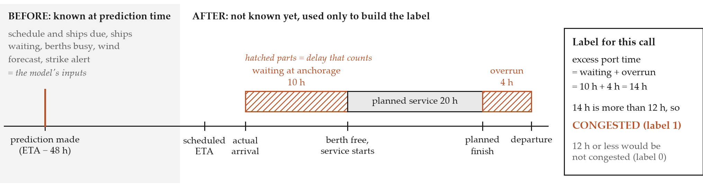
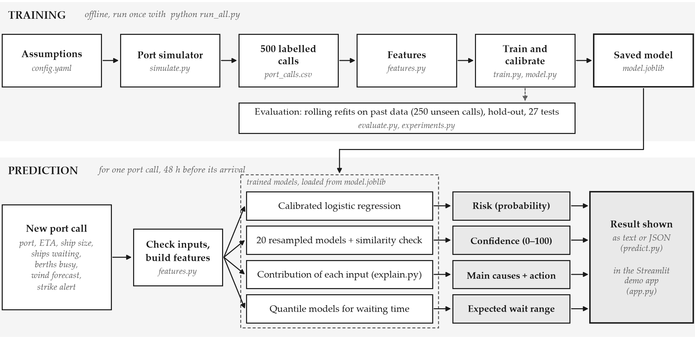

# Predicting Port Congestion and Shipment Delays

<!-- center -->
Technical report for the Aiqon take-home technical challenge

<!-- center -->
Hanzala Ahmed, November 2026 · Code: [github.com/hanzala777/aiqon](https://github.com/hanzala777/aiqon)

## Summary

- Predicts, 48 hours before a ship's scheduled arrival, the chance that the port call is delayed by over 12 hours.
- Returns a probability, a confidence score (0–100), the main causes and a suggested action.
- Trained and tested only on a simulated year at five ports, where delays come from ships queueing for berths.
- ROC-AUC (Area Under the Receiver Operating Characteristic curve) of 0.85, against 0.81 for a rule of thumb.

## 1. Problem and label

- User: a planner deciding two days ahead whether to re-time the arrival, switch port or warn the customer.
- Label: congested if anchorage wait + berth overrun is more than 12 hours (Figure 1).
- Inputs must be known 48 h before the ETA (Estimated Time of Arrival); a unit test guards against leakage.



*Figure 1: How one port call is labelled. Only the left part is available to the model.*

## 2. Data

- Simulated: building port calls from raw AIS (Automatic Identification System) data would not fit in three days.
- 5 ports (3–12 berths), one year, hour by hour; ships are served first come, first served.
- Seasonal peaks, schedule surges, storms, strikes and night shifts slow the work.
- 10,723 calls simulated, 500 sampled (23% congested).
- Inputs are noisy on purpose: a wind forecast instead of real wind, imperfect strike alerts, 5% missing values.

## 3. Features

- All are available two days ahead (Table 1).
- Key feature: pressure index = (ships waiting + berths busy + ships due before ours) ÷ berths.
- Missing values are filled with the training median and lower the confidence; invalid inputs are rejected.

*Table 1: Model inputs (TEU = twenty-foot equivalent unit, a measure of ship size).*

<!-- cols: 16,60,24 -->
| Group | Features | Source in practice |
|---|---|---|
| Traffic | ships waiting, berths busy, 7-day utilisation, arrivals due, pressure index | AIS, terminal systems |
| Port | number of berths, port, share of calls delayed in the last 30 days | port statistics |
| Weather, labour | wind forecast, storm forecast, strike alert | forecasts, port authority |
| Vessel, time | ship size (TEU), hour, weekend, month | schedule |

## 4. Model and outputs

- Split by time: 350 calls to train (Jan–Sep), 75 to calibrate, 75 to test (Nov–Dec).
- Compared a rule of thumb, logistic regression and LightGBM (Light Gradient-Boosting Machine).
- Chosen: logistic regression, which beat LightGBM in all 5 time-based folds (ROC-AUC 0.86 vs 0.81).
- Domain rule: more traffic, wind, strikes or ship size can never lower the risk.
- Confidence = 50% agreement of 20 resampled models + 25% data completeness + 25% similarity to past data.
- Causes = each input's contribution (its SHAP, SHapley Additive exPlanations, value), grouped into factors.
- Act when risk ≥ 0.17, assuming a missed delay costs 5 times a false alarm.



*Figure 2: System architecture. The training pipeline runs once; the prediction path runs for each port call.*

<!-- small -->
Example output for one call (shortened):

```
HIGH congestion risk (>99%, confidence 63%). Expected anchorage wait ~38h (80% range 9-48h).
  + +6.70  heavy traffic: 22 vessels due in the 48h before ETA, 6 waiting at anchorage, 6/6 berths occupied
  + +1.85  storm risk: forecast wind 35 kn (cranes stop above 32 kn)
  * Request a later berth window or slow-steam to arrive after the peak
```

## 5. Results

- Main test (rolling origin): refit 5 times on past data, test on the next period; 250 unseen calls in total.

*Table 2: Results on the 250 rolling-origin calls; last column is the 75-call hold-out. CI = confidence interval. PR-AUC = area under the precision–recall curve. Brier = error of the probabilities (lower is better).*

<!-- cols: 27,17,9,9,19,19 -->
| Model | ROC-AUC [95% CI] | PR-AUC | Brier | Precision / recall at 0.17 | Hold-out ROC-AUC |
|---|---|---|---|---|---|
| Logistic regression | **0.85** [0.79–0.90] | **0.76** | **0.13** | 0.48 / 0.88 | **0.87** |
| LightGBM | 0.81 [0.74–0.86] | 0.72 | 0.15 | 0.45 / 0.83 | 0.82 |
| Rule of thumb | 0.81 [0.75–0.86] | 0.62 | – | 0.64 / 0.60 | 0.83 |

<!-- width: 72 -->


*Figure 3: ROC curve, precision–recall curve and calibration on the 250 rolling-origin calls.*

- Catches 88% of congested calls; decision cost 236 against 350 for the rule of thumb.
- Confidence is meaningful: the Brier score falls from 0.18 (least confident third) to 0.08 (most confident).
- Stable: ROC-AUC 0.81 ± 0.05 on 5 other simulated years, and 0.88 with 15% missing data.
- Weakness: storms at quiet ports (2 of 8 storm-hit calls missed).

## 6. Limitations and next steps

- Simulated data only, with simplified operations (no priorities, tides or diversions).
- The domain rule is an assumption; the hold-out is small (75 calls); the costs are placeholders.
- Next: a real AIS data pipeline, per-port retraining, a storm risk floor, and an API (Application Programming Interface) for the JSON (JavaScript Object Notation) output.
