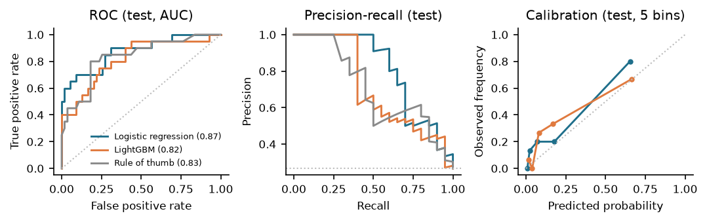
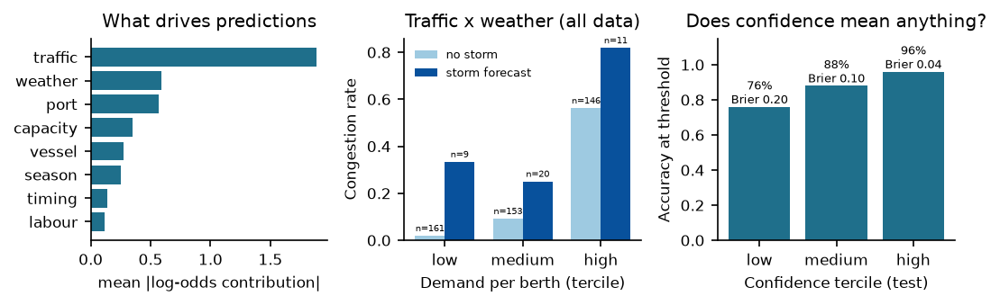

# Predicting Port Congestion and Shipment Delays

**Aiqon AI Internship – Technical Report** · Hanzala Ahmed · November 2026

## 1. Problem framing

**Decision supported.** 48 hours before a vessel's scheduled arrival, a planner (carrier, forwarder or terminal) must decide whether to act: re-time the arrival, divert, or warn the customer. The system therefore answers one question per port call: *will this call lose more than 12 hours against plan?* It returns a probability, a confidence score, the factors behind it, and a suggested action.

**Definition of congestion (ground truth).** *Excess port time* = anchorage waiting time + berth overrun beyond the terminal's planned service time. A call is **congested if excess time > 12 h**. I first labelled calls by "turnaround > 1.5× port median". I dropped it because it flagged large ships simply for being large: a long *planned* stay is not congestion. Sensitivity to the 12 h threshold is reported in §5.

**Prediction horizon and leakage.** Every feature must be known at *ETA − 48 h*. Realised quantities (actual arrival, storm during the stay, wait time) are used only to build labels. A unit test checks this: scrambling every outcome column leaves the feature matrix unchanged.

## 2. Data: a queueing simulation, not a formula

Turning raw AIS position pings into labelled port calls (geofencing anchorages, splitting calls, deriving waits) is a project in its own right. I chose a synthetic dataset instead and made it **mechanistic**: congestion *emerges* from a simulated queue rather than being drawn from `label = f(features) + noise`.

- **5 fictional ports** (3–12 berths) with different vessel sizes, crane productivity and regional weather, simulated hour by hour for one year (**10,723 calls**). **500 calls** are sampled as the modelling dataset (23% congested).
- **Arrivals:** a Poisson process with seasonal (Aug–Nov peak), weekday and *schedule-surge* (bunching) effects. Actual arrival = scheduled ETA + N(0, 6 h).
- **Service:** first-come-first-served berths. Work = 35% of TEU capacity ÷ port productivity, plus 4 h. Productivity drops to 0 in storms (wind > 32 kn, the crane limit), 0.6 during labour action, and 0.8 at night.
- **Imperfect observations:** the model sees a wind *forecast* (± 4 kn error), not the actual weather. Labour alerts have 85% recall and a 2% false-alarm rate. 5% of live-feed values are missing at random (AIS / forecast outages).

*A bug I found and fixed:* my first calibration used ±20% seasonal swings. That pushed the small ports to near-100% utilisation, so their queues stayed unstable for months and 84% of the test period was congested. The task collapsed into "predict the month". I damped the seasonality to ±12% and checked queue stability across several random seeds.

## 3. Features

| Group | Features (all known at ETA − 48 h) | Real-world source |
|---|---|---|
| Traffic / capacity | vessels at anchorage, berths occupied, 7-day utilisation, arrivals scheduled before ETA and within ±24 h, **pressure index** = (queue + occupied + scheduled-ahead) / berths | AIS, terminal systems, pre-arrival notices |
| Weather / labour | forecast max wind, storm-forecast flag, labour-action alert | forecast feed, port authority |
| Port & vessel | berths, port identity, 30-day delay rate, vessel TEU | port statistics |
| Time | hour, weekend, month (sin/cos), peak-season flag | schedule |

Missing values are filled with the *training-set* median. Missing-value indicator columns were tested and removed: missingness here is random, so they added noise (CV AUC 0.859 vs 0.863) and appeared as spurious "drivers". Missing data is surfaced through the confidence score instead.

## 4. Models, confidence and explanations

- **Split:** chronological, with 350 calls for training (Jan–Sep), 75 for validation and 75 for testing (Nov–Dec). This mimics deployment: train on the past, predict the future.
- **Candidates:** (a) a *rule of thumb*: flag if pressure index > 3.5 vessels per berth or a storm is forecast, with the threshold tuned on training data; (b) L2-regularised **logistic regression**; (c) **LightGBM**. Probabilities are Platt-calibrated on the validation slice.
- **Choice: logistic regression.** It beat LightGBM on every fold of a 5-fold rolling-origin evaluation (AUC 0.86 vs 0.81). With 350 training rows the trees overfit, and the data shows little non-additive structure: in Fig. 2 (centre), a storm forecast raises congestion at every traffic level, which a linear logit captures. LightGBM stays in the code as a challenger, together with its SHAP interaction analysis.
- **Confidence (0–100)** is kept separate from the probability. It answers "how much should I trust this number?", not "how sure is the event?". It combines **50% model agreement** (1 − spread of 20 bootstrap-refitted models), **25% data completeness** (share of live feeds actually observed) and **25% familiarity** (k-NN distance to the training data, flagging extrapolation). A 50% risk with 95% confidence means "genuinely a coin flip". A 50% risk with 40% confidence means "refresh the data first".
- **Explanations:** for a linear model, coefficient × standardised value is the exact SHAP value. Contributions are summed into operational factors (traffic, weather, labour, port, capacity, vessel, season, timing). The traffic features are correlated, and individual coefficients can flip sign while the factor total stays stable and meaningful. Each factor becomes a sentence with real numbers, and the top factors map to actions.
- **Decision threshold** = 0.27, chosen on validation data to minimise expected cost, with a missed delay costing 10 and a false alarm costing 2 (illustrative weights; they should come from the user's real demurrage and penalty figures). With perfectly calibrated probabilities the theoretical optimum would be 2 / 12 = 0.17.
- **Expected wait:** LightGBM quantile regressors (P10 / P50 / P90).

Example output: *"HIGH congestion risk (>99%, confidence 90%). Main drivers: heavy traffic: 22 vessels due in the 48 h before ETA, 6 waiting at anchorage, 6/6 berths occupied (7-day utilisation 92%); storm risk: forecast wind 35 kn (cranes stop above 32 kn). Expected anchorage wait ~38 h (80% range 9–48 h). → Request a later berth window / slow-steam; add a weather buffer to the customer ETA."*

## 5. Results

| Test set (75 calls, 27% congested) | ROC-AUC [95% CI] | PR-AUC | Brier | Precision / Recall @ threshold | Rolling-CV AUC |
|---|---|---|---|---|---|
| **Logistic regression (production)** | **0.87** [0.76–0.96] | **0.81** | **0.11** | 0.81 / 0.65 | **0.86 ± 0.05** |
| LightGBM (challenger) | 0.82 [0.70–0.93] | 0.71 | 0.14 | 0.63 / 0.50 | 0.81 ± 0.07 |
| Rule of thumb | 0.83 [0.72–0.93] | 0.70 | – | 0.57 / 0.80 | 0.81 ± 0.04 |

*Figure 1 – Test-set discrimination and calibration. With only 75 test calls the curves are step-like; rolling-origin CV in the table is the more stable comparison.*

*Figure 2 – Left: global factor importance (production model). Centre: observed congestion rate by traffic level and storm forecast (all 500 calls). Right: accuracy by confidence tercile (test).*

**What the results show:**

- **Drivers match the simulation.** Global factor importance ranks traffic first (1.9), then weather (0.6), port (0.6) and capacity (0.3), with labour last. That matches the simulator's mechanism. Labour shows weak signal because there were only about 2 short episodes per port.
- **The confidence score carries information.** Accuracy rises from 76% to 88% to 96%, and Brier falls from 0.20 to 0.04, across the low, medium and high confidence terciles (Fig. 2, right).
- **Wait-time estimate.** MAE is 4.9 h, compared with 8.1 h for predicting the median. However, the P10–P90 interval covers only 67% of actual waits (the target is 80%), so the intervals are too narrow.
- **Label threshold.** AUC is 0.84 at 6 h, 0.87 at 12 h and 0.95 at 24 h. Long delays are easier to anticipate than marginal ones.
- **Data quality.** With 15% of feed values missing, AUC stays at 0.88. With ETA noise doubled to 12 h, it falls to 0.86. The confidence score drops accordingly (77 → 65 on average).
- **Error analysis: storms at quiet ports.** All 8 test calls hit by a storm were congested, and all 8 storms had been correctly forecast (about 35 kn). The model caught 6. The 2 misses (risk 2% and 10%) were at ports with *empty anchorages*, where light traffic outweighed the storm in the model. Yet a crane shutdown of 12 h or more alone pushes a berthed ship past the threshold. Storm-forecast calls are rare in training (about 8%), so the storm effect is underestimated. More storm history, or a rule that never lets risk fall below a floor when the forecast exceeds 32 kn, would fix this.

**Honest caveats on these numbers:**

1. **Test AUC 0.87 is a favourable draw.** Re-running the *whole pipeline* on 5 other simulated years gives AUC **0.79 ± 0.06** for logistic regression, 0.78 ± 0.09 for LightGBM and 0.73 ± 0.07 for the rule. The ranking usually holds, but not always: LightGBM won one of the five.
2. **The cost comparison is inconclusive.** On this test slice the tuned rule of thumb had a *lower* operational cost than the model (64 vs 76; never acting costs 200). The 95% bootstrap interval for the difference is [−20, +52]. One missed delay changes the cost by 10, so 75 calls cannot separate them.
3. **Per-port metrics rest on 8–28 calls each.** The hub's AUC of 0.59 rests on 3 congested calls and isn't meaningful.

## 6. Assumptions and limitations

- **Everything is synthetic.** The results show the *method* works on a plausible world whose rules I wrote. They are not evidence of accuracy on a real port. The model will recover structure I put in, and real ports have mechanisms I left out.
- **Simplified port operations:** first-come-first-served only (real terminals have priority windows and berth contracts), no tides or pilotage, no yard or gate congestion, no knock-on effects between ports, and no carriers diverting away from congested ports (which in reality limits queue growth).
- **Small data.** 500 records give wide confidence intervals, so the model choice and thresholds should be revalidated on more data.
- **Quantile intervals under-cover** (67% vs 80%). They should be recalibrated, for example with conformal prediction.

## 7. Next steps toward production

1. **Real data pipeline:** geofence anchorage and berth polygons in AIS (MarineCadastre), derive waiting times from vessel positions, and join weather forecasts and port-call schedules.
2. Retrain per port with **rolling-window retraining** and drift monitoring, and add a *carrier-diversion* feedback loop to the simulator.
3. **Calibrate the costs with users** (demurrage, missed rail connections), and replace the sigmoid calibrator and quantile intervals with conformal methods.
4. Ship as an API that serves the JSON output (`python -m src.predict --json`) to planning dashboards.

*Code, reproduction instructions and the demo are in the repository (`python run_all.py` reproduces every number in this report in under a minute).*
